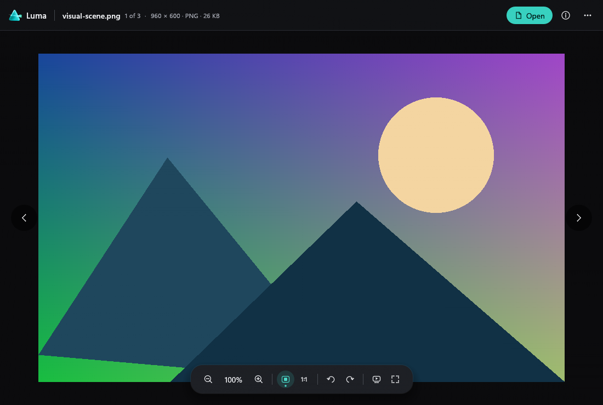

# Sonora, Luma and Vesper

Three independent, offline Windows apps: a music player, photo viewer and video player.
Native Rust windows, no Electron, accounts, telemetry or background service.

| App | What it does | Windows package |
| --- | --- | --- |
| Sonora | Local music, queue/playlists, artwork, crossfade and Windows media controls | Sonora-0.2.1-Setup.exe |
| Luma | Photos, fast navigation, zoom/rotation, animations, metadata and clipboard/Explorer actions | Luma-0.2.1-Setup.exe |
| Vesper | Video, 4K decoding, subtitles, tracks, speed, resume and optional browser subtitle search | Vesper-0.2.1-Setup.exe |

[Download the latest release](https://github.com/v2matosevic/Version2Desktop/releases/latest)
 · [Installation](docs/INSTALL.md) · [User guide](docs/USER-GUIDE.md)
 · [Formats and limits](docs/FORMATS.md) · [Build from source](docs/BUILD.md)

Choose only the apps you need. Each installer includes its complete runtime. Portable ZIPs
are also available. No installer changes your chosen default apps.

## Sonora

Remembered crossfade from off to 12 seconds, bounded streaming playback, shuffle/repeat,
playlist files, source/output details and native Windows media controls. Windows shared audio
does not promise bit-perfect output; AAC/M4A encoder padding can affect gapless playback.

## Luma

Keeps the current photo visible while the next loads, reads ahead in the direction of travel,
shows EXIF details, plays supported animations and offers explicit Explorer/clipboard actions.
Rotation changes the view, never the original file. HEIC/RAW/JPEG XL depend on installed Windows codecs.

## Vesper

File validation and player initialization run off the UI thread, with cancellation and latest-file
handling. Supports measured 4K codec profiles, local text/embedded subtitles, encoding overrides,
audio-track selection, frame stepping and playback speed. Subtitle search opens a provider in
your browser after your click; download there and load the subtitle locally. No account is required
for local playback. Provider download rules may vary.

The images show actual application UI with generated demonstration media. They do not show private
user files or certify another computer's hardware, color output or input behavior.

## Requirements and licensing

Windows 10/11 x64 and an OpenGL-capable graphics driver. Development verification used Windows 11.
Rare codecs, HDR display output and other GPUs are conditional or unverified; see the format guide.

First-party code and original artwork are [MIT licensed](LICENSE). Dependencies retain their licenses.
Vesper's Windows distribution contains GPL components and is distributed under GPL-3.0-or-later;
its first-party MIT source is compatible with that distribution. Exact decoder package/source
provenance and all notices accompany the release. [Licensing details](docs/LICENSING.md).

## Contributing

[Build and checks](docs/BUILD.md), [contributing](CONTRIBUTING.md) and [security reports](SECURITY.md).
Please include the app/version, Windows version, format/codec and a reproducible description in
bug reports. Do not upload private media, credentials or unredacted logs.
